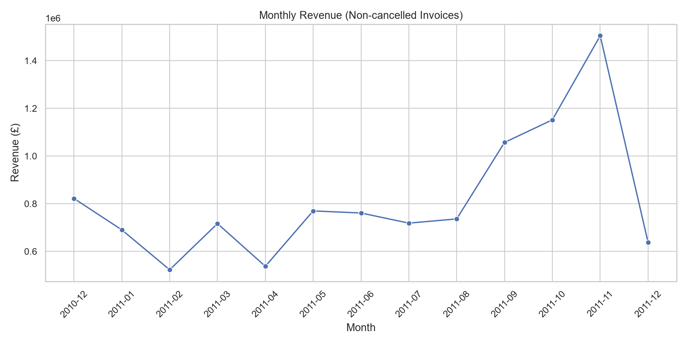
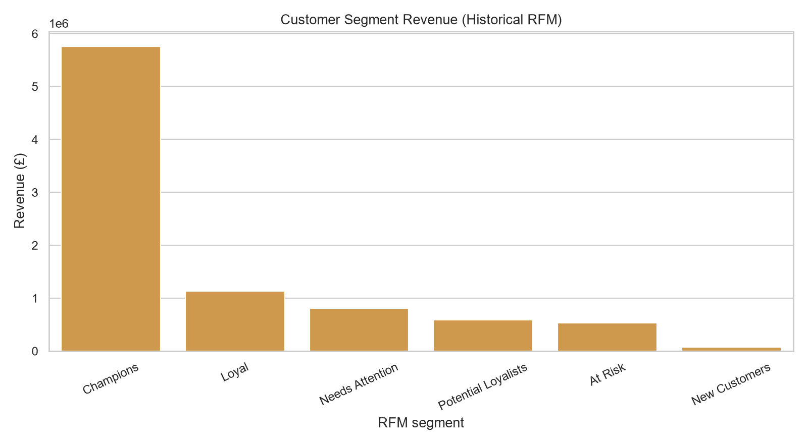

# E-Commerce Sales Analytics

An end-to-end portfolio project for analyzing transaction-level online retail data with Python, MySQL, and Power BI. The project emphasizes reproducible metric definitions and evidence-based recommendations—not just charts.

## Business problem

The retailer needs to understand revenue performance, product mix, repeat purchasing, and country concentration. The supplied data includes cancellation-coded invoices and a substantial share of transactions without customer IDs, so reporting must distinguish order-level sales measures from row-level data quality measures.

## Objectives

- Validate and prepare the transaction data without overwriting the supplied CSVs.
- Analyze monthly/yearly sales, products, countries, customers, RFM segments, and order-value outliers.
- Use SQL CTEs, joins, aggregates, CASE logic, and window functions to answer business questions.
- Prepare a Power BI star-schema dataset, DAX measures, and a manual dashboard build guide.
- Document calculated findings, assumptions, limitations, and interview explanations.

## Dataset

- **Dataset:** Online Retail transactions from a UK-based, non-store retailer.
- **Source:** [UCI Machine Learning Repository — Online Retail](https://archive.ics.uci.edu/dataset/352/online+retail).
- **Period in the supplied export:** 2010-12-01 through 2011-12-09; December 2011 is partial.
- **Supplied files:** [cleaned_sales.csv](data/cleaned_sales.csv) and [cleaned_sales_mysql.csv](data/cleaned_sales_mysql.csv), each containing 536,641 invoice-line rows and nine fields.
- The raw Excel workbook referenced by the legacy notebook is not included in this clone. The reproducible pipeline uses the supplied `cleaned_sales.csv` and does not claim to redo cleaning from the original workbook.
- The two supplied exports differ in CustomerID text formatting and floating-point revenue representation. The analysis normalizes IDs and recomputes line revenue from quantity and unit price.

### Metric definitions

- **Invoice line:** one row in the transaction table.
- **Cancellation-coded invoice:** `InvoiceNo` begins with `C`, case-insensitive.
- **Revenue:** quantity multiplied by unit price, rounded to two decimals per line.
- **Sales revenue / orders:** cancellation-coded invoices are excluded; non-cancelled negative adjustments remain in net sales.
- **Customer measures:** only non-missing CustomerIDs are included.
- **Repeat customer:** an identified customer with more than one distinct non-cancelled invoice in this observation window.
- **RFM snapshot:** the day after the last non-cancelled transaction in the export.

These definitions explain why the original Power BI screenshot and README displayed different revenue/order/AOV totals: one included cancellation-coded invoices and one excluded them. See the generated [business insights report](reports/business_insights.md) for the calculation basis and row-versus-invoice cancellation rates.

## Project workflow

```text
Supplied transaction CSV
    → Python validation, cleaning, EDA and RFM
    → CSV/JSON reports and saved visualizations
    → MySQL 8 business-query pack
    → Power BI model files, DAX measures and manual build guide
    → Streamlit interactive dashboard
    → Evidence-based business insights and interview notes
```

## Project structure

```text
.
├── data/                         # Supplied transaction exports; source files preserved
├── python/
│   ├── ecommerce_analysis.py     # Reproducible analysis pipeline
│   └── ecommerce_analysis.ipynb # Preserved legacy walkthrough
├── sql/
│   ├── database_setup_portfolio.sql
│   ├── business_analysis.sql
│   └── legacy SQL learning scripts
├── powerbi/
│   ├── data/                    # Generated Power BI model tables
│   ├── BUILD_GUIDE.md
│   ├── DAX_MEASURES.dax
│   └── ecommerce_sales_customer_analytics.pbix  # Original report, preserved
├── streamlit_app.py              # Interactive web dashboard
├── .streamlit/config.toml         # Streamlit theme and server configuration
├── reports/                     # Generated KPIs, data quality, trends, RFM, insights
├── visualizations/              # Generated Matplotlib/Seaborn charts
├── screenshots/                 # Existing notebook, SQL and original Power BI screenshots
├── tests/
├── requirements.txt
├── requirements-notebook.txt
├── INTERVIEW_PREPARATION.md
└── README.md
```

## Python analysis

The canonical pipeline is [python/ecommerce_analysis.py](python/ecommerce_analysis.py). It:

- Validates required columns, timestamps, numeric fields, and identifier types.
- Removes exact duplicate rows only; it retains cancellation-coded invoices and negative adjustments for explicit analysis.
- Leaves missing CustomerIDs and descriptions visible in the quality report rather than filling them with invented values.
- Recomputes line revenue from `Quantity × UnitPrice`.
- Calculates overall KPIs, annual/monthly revenue and month-over-month change, products, countries, customer purchasing behavior, monthly new/returning activity, cohort retention, RFM scores, and IQR-flagged invoice outliers.
- Saves reproducible chart images and a Power BI model export.

Run from the repository root:

```bash
python python/ecommerce_analysis.py
```

Optional paths can be supplied with `--input`, `--reports-dir`, `--visualizations-dir`, and `--powerbi-dir`. The script reads but does not overwrite the supplied source CSV.

## SQL analysis

Run [sql/database_setup_portfolio.sql](sql/database_setup_portfolio.sql), import the supplied CSV into the `sales` table using MySQL Workbench, then run [sql/business_analysis.sql](sql/business_analysis.sql) on MySQL 8. The analysis pack covers:

- Overall KPIs and separately labeled cancellation row/invoice rates.
- Calendar-complete monthly revenue, AOV, and month-over-month growth.
- Yearly trends, product ranking, above-average products, customer ranking, repeat rate, and monthly new/returning customers.
- Country performance, top products by country, RFM segments, 90-day inactivity flags, and a `LEFT JOIN` example for unidentified customer rows.

The legacy SQL files remain available as learning history. The portfolio setup file avoids creating empty customer/product tables before loading sales data. The SQL pack targets MySQL 8; a MySQL server/client was not available in this workspace, so the SQL has not been executed against a live database.

## Power BI

The original [PBIX file](powerbi/ecommerce_sales_customer_analytics.pbix) is preserved. Its existing report has four pages; it was not edited in this environment. The new [Power BI data exports](powerbi/data/) include a transaction fact table, date/customer/product/country dimensions, and a pre-aggregated cohort-retention table.

Use [powerbi/BUILD_GUIDE.md](powerbi/BUILD_GUIDE.md) and [powerbi/DAX_MEASURES.dax](powerbi/DAX_MEASURES.dax) to build the requested five pages in Power BI Desktop:

1. Executive Overview
2. Product Analysis
3. Customer Analysis
4. Regional Analysis (country is the available geographic level)
5. Sales Trends

**The five-page dashboard has not been created.** The guide also covers slicers, drill-through, tooltips, conditional formatting, model relationships, and validation. Profit, product categories, and finer-grained regions are not available in the supplied data.

## Streamlit dashboard

The repository includes an implemented Streamlit app in [streamlit_app.py](streamlit_app.py). It reuses the tested Python analysis module and provides date/country filters, executive KPIs, product and customer views, country comparisons, trends, data-quality checks, and CSV downloads. The original Power BI report remains preserved and is a separate deliverable.

Run locally from the repository root:

```bash
python -m pip install -r requirements.txt
streamlit run streamlit_app.py
```

### Deploy to Streamlit Community Cloud

1. Push this repository to a GitHub repository accessible to Streamlit Community Cloud. Keep `data/cleaned_sales.csv` in the repository; the app reads it relative to its own file path.
2. In [Streamlit Community Cloud](https://share.streamlit.io/), create an app from the repository and branch, set the main file to `streamlit_app.py`, and deploy.
3. Use `requirements.txt` as the app dependency file. No database or Streamlit secrets are required by the app. Do not commit credentials; `.streamlit/secrets.toml` is ignored.
4. Verify the app loads and reconcile its unfiltered values to the KPI table below. The first request performs analysis; results are cached and refreshed when the CSV file changes.

The app and deployment configuration are prepared, but **the project has not been deployed to a public Streamlit URL**.

## Calculated findings

All figures below are calculated by the pipeline on the documented non-cancelled-invoice basis:

| Measure | Result |
|---|---:|
| Revenue | £10,619,986.68 |
| Orders | 22,064 |
| Identified customers | 4,339 |
| Average order value | £481.33 |
| Repeat customers | 2,845 (65.6% of identified customers) |
| Products / countries | 4,059 / 38 |
| Revenue from the UK | £8,979,619.97 (84.6%) |
| Invoice-level cancellation share | 3,836 of 25,900 invoice IDs (14.8%) |
| Cancellation-coded row share | 1.7% of transaction rows |

### Business interpretation

- November 2011 is the highest-revenue month at **£1,503,866.78**; February 2011 is lowest at **£522,545.56**. With one complete annual cycle and a partial December, this is descriptive evidence, not proof of recurring seasonality.
- `DOTCOM POSTAGE` is the highest-revenue stock code overall (**£206,248.77**), showing why fee-like lines should be reviewed separately from merchandise. Using the documented POSTAGE/CARRIAGE description review rule, the leading merchandise-coded item is `REGENCY CAKESTAND 3 TIER` (**£174,156.54**). The rule affects product ranking only, not total revenue.
- The largest RFM revenue segment is **Champions** (**£5,759,202.78**). This is historical value during the observed period, not predictive lifetime value.
- The relative-RFM **At Risk** segment contains **555 customers** and £532,291.11 in observed revenue; it is a prioritization flag, not a churn prediction.
- **25.2%** of rows have no CustomerID, limiting customer attribution. The top 10 identified customers contribute 14.5% of total sales revenue.
- **No cost data** is supplied, so profit and margin claims are not made. No product category, region, campaign, or acquisition-channel field is supplied, so category/sub-country analysis and causal drivers of repeat purchases require additional validated data.

The full calculation and recommendations are in [reports/business_insights.md](reports/business_insights.md). Generated charts include:





Existing screenshots of the original report are retained, for example [executive overview](screenshots/powerbi/executive_overview.png) and [customer analysis](screenshots/powerbi/Customer_Analysis.png); they are not screenshots of a newly built five-page dashboard.

## Installation and validation

Use Python 3.10 or newer. Install optional notebook/MySQL dependencies with `python -m pip install -r requirements-notebook.txt`.

```bash
python -m venv .venv
# Windows PowerShell:
.venv\Scripts\Activate.ps1
python -m pip install -r requirements.txt
python python/ecommerce_analysis.py
python -m unittest discover -s tests -v
streamlit run streamlit_app.py
```

The optional legacy notebook also references a raw Excel workbook that is absent from the clone and includes MySQL upload experiments. Its database connection cells now read credentials from `MYSQL_HOST`, `MYSQL_USER`, `MYSQL_PASSWORD`, and `MYSQL_DATABASE`; do not commit real credentials.

## Skills demonstrated

Data validation and cleaning, Pandas/NumPy, EDA, Matplotlib/Seaborn, transaction-grain KPI design, RFM segmentation, cohort analysis, outlier interpretation, MySQL joins/CTEs/subqueries/windows, DAX, Power BI star-schema planning, metric reconciliation, data storytelling, and documenting analytical limitations.

